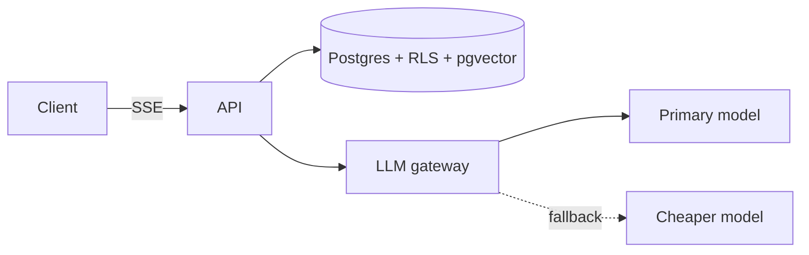

# <Title: the problem, not the technology. e.g. "Keeping 200 tenants' data apart in one Postgres">

> <One-paragraph summary: problem, what we built, the headline number, the main trade-off.>

## The problem
<Who hurts and how, with numbers. Constraints: team size, budget, deadlines, compliance.>

## Architecture

<Walk through one request end to end.>

## Key decisions
| Decision | Chosen | Rejected | Why (link ADR) |
|---|---|---|---|
| | | | [ADR-0001](../adr/0001-...md) |

## Numbers
<Latency, throughput, cost per request or tenant, cache hit rate: from benchmark reports, with links. Never estimated figures presented as measured.>

## What went wrong / what surprised us
<The most valuable section. Bugs found by the verification tests, wrong assumptions, rollbacks.>

## What we'd do differently / next
